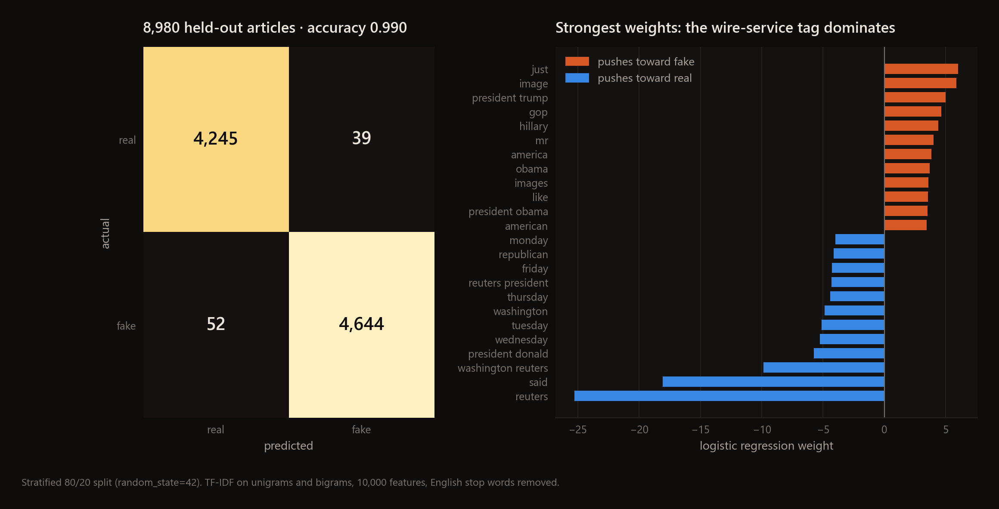
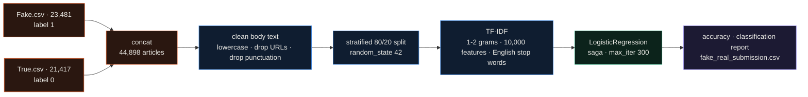
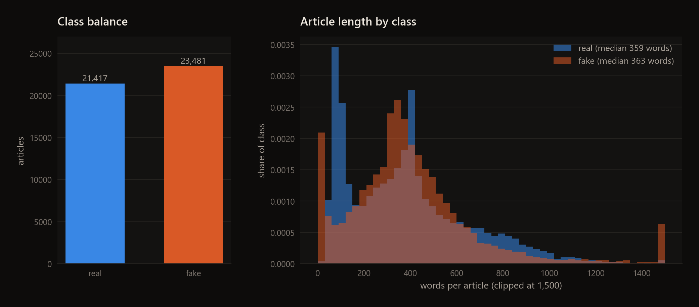
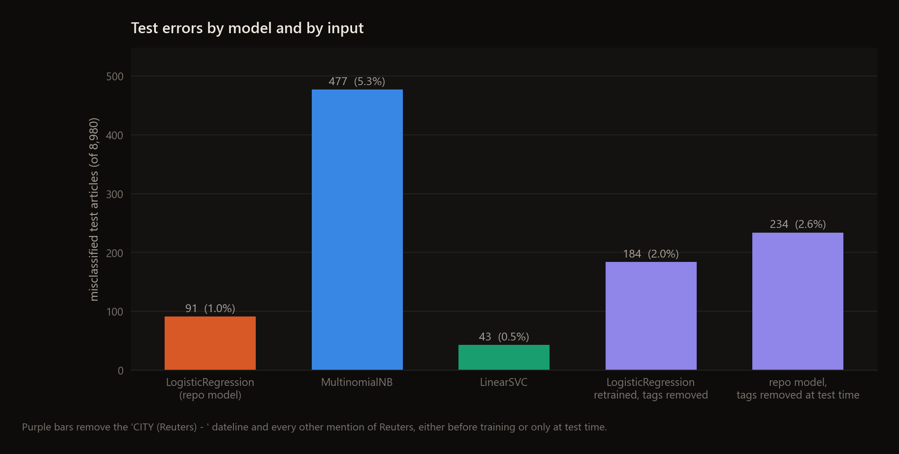

<div align="center">

# Fake News Detection

**A fake-vs-real news classifier on the Kaggle Fake and Real News dataset: TF-IDF bigrams and logistic regression, plus a check on how much of the score comes from one word.**




</div>

I wrote this on Kaggle as a single script: it reads the two CSVs, plots the label and length
distributions, trains a logistic regression on the article body and writes test-set predictions to a CSV. This repo
is the analysis version, with no saved model and no interface;
[news-detector-app](https://github.com/EllE961/news-detector-app) is the desktop version, which retrains the same
model with the subject and date columns added and wraps it in a PyQt5 window.

## Highlights

- Logistic regression on TF-IDF features gets 0.990 accuracy on 8,980 held-out articles (91 mistakes), matching the 0.9899 in the original version of this README.
- The strongest single feature is the word "reuters". 99.2% of the real articles open with a `CITY (Reuters) -` dateline, against 9 of the 23,481 fake ones.
- Removing those tags from the test articles only, with the model unchanged, raises the error count from 91 to 234, and 184 of those are real articles now called fake.
- Retrained without the tags, the same pipeline still reaches 0.980. The next layer of features is house style: "said", weekday names and "edt" on the real side, "just", "image", "gop" and "hillary" on the fake side.
- A LinearSVC on the same features makes 43 mistakes (0.995); Multinomial Naive Bayes makes 477 (0.947).

---

## How it works



Only the `text` column goes into the model; `title`, `subject` and `date` are ignored. The vectorizer is fitted on
the 35,918 training articles only.



The classes are close to balanced and the two length distributions overlap (median 359 words for real, 363 for
fake), so neither prior nor length gives much away. The spike at zero on the fake side is 630 articles whose body is
empty in the source CSV.

## Results

Same stratified 80/20 split as the script (8,980 test articles). The first bar is the repo's model. The purple bars
take the Reuters dateline and every other mention of "Reuters" out of the text, either before training or only at
test time.



| setup | accuracy | errors | real called fake | fake called real |
|---|---|---|---|---|
| LogisticRegression (repo model) | **0.990** | 91 | 39 | 52 |
| MultinomialNB, same features | 0.947 | 477 | 238 | 239 |
| LinearSVC, same features | **0.995** | 43 | 22 | 21 |
| LogisticRegression retrained without Reuters tags | 0.980 | 184 | 81 | 103 |
| repo model, Reuters tags removed from test text | 0.974 | 234 | 184 | 50 |

The last row is the one that matters for real use. The real class in this dataset is almost entirely Reuters wire
copy from 2016 and 2017, so the model has partly learned "is this a Reuters article". Take the tag away and it falls
back on wire-service habits, which still separate the two sources well inside this dataset but say nothing about
whether a story is true.

## Quickstart

```bash
git clone https://github.com/EllE961/Fake-News-Detection.git
cd Fake-News-Detection
pip install -r requirements.txt

# the dataset is not in this repo: Fake.csv and True.csv from Kaggle (clmentbisaillon/fake-and-real-news-dataset),
# or the copies in news-detector-app
mkdir data
curl -L -o data/Fake.csv https://raw.githubusercontent.com/EllE961/news-detector-app/main/data/Fake.csv
curl -L -o data/True.csv https://raw.githubusercontent.com/EllE961/news-detector-app/main/data/True.csv

python fake_vs_real_kaggle.py      # about 2 min: two plot windows, the report, fake_real_submission.csv
python scripts/make_figures.py     # about 4.5 min: every number and figure in this README
```

On Kaggle the script reads the dataset from `/kaggle/input/fake-and-real-news-dataset` instead.

## Repository map

```text
fake_vs_real_kaggle.py    the whole pipeline: load, EDA plots, clean, split, TF-IDF, logistic regression, report
scripts/make_figures.py   reruns it, adds the comparison models and the Reuters ablation, writes docs/assets/
docs/assets/              figures used in this README
requirements.txt          versions I ran it with
data/                     Fake.csv and True.csv go here (git-ignored, 116 MB)
```

## Limitations

- The labels come from the source, not from fact-checking each article: real means Reuters, fake means one of the sites flagged by PolitiFact and Wikipedia. A classifier trained on that split learns the sources' writing styles, and it will not carry over to other outlets or later years.
- The text still carries other source fingerprints: "Featured image" credits appear in 8,161 fake articles and "21st Century Wire" in 1,254, and neither appears in any real one. I only removed the Reuters tags.
- 6,252 rows repeat the text of an earlier row (the 630 empty fake articles among them), and the split doesn't group duplicates, so some test articles have an identical copy in the training set.
- One split, no cross-validation and no tuning. The comparison models use default settings.
- The script retrains on every run and saves nothing. The pickled model lives in [news-detector-app](https://github.com/EllE961/news-detector-app).

Dataset: Ahmed, Traore and Saad, ISOT Fake News dataset (University of Victoria), via the Kaggle upload by Clément Bisaillon.

## License

MIT, see [LICENSE](LICENSE).
