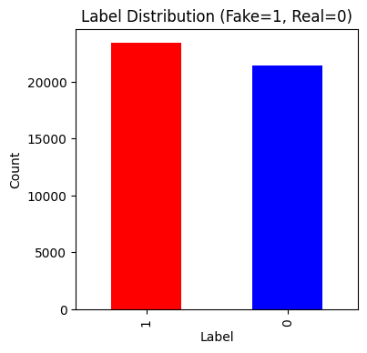
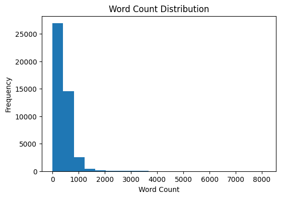

# Fake and Real News Detection

A **Logistic Regression-based classifier** to predict whether a news article is **fake** or **real**. This project uses the **Fake and Real News dataset** to train a text-based classification model with high accuracy.

## Dataset:
- The dataset can be found here: [Fake and Real News Dataset](https://www.kaggle.com/datasets/clmentbisaillon/fake-and-real-news-dataset)

## How It Works:
1. **Load the Dataset**:
   - Combine `Fake.csv` (fake news) and `True.csv` (real news) into a single DataFrame.
   - Assign labels: `1` for Fake and `0` for Real.
2. **Exploratory Data Analysis (EDA)**:
   - Visualize the distribution of labels.
   - Analyze word count distribution.
3. **Preprocessing**:
   - Clean the text by:
     - Converting to lowercase.
     - Removing URLs, punctuation, and extra spaces.
   - Add a `word_count` column to analyze the length of articles.
4. **TF-IDF Vectorization**:
   - Use `TfidfVectorizer` with:
     - Maximum of 10,000 features.
     - N-grams ranging from unigrams to bigrams.
     - English stop words removed.
5. **Model Training**:
   - Train a `LogisticRegression` model with:
     - `solver="saga"`
     - `max_iter=300`
6. **Evaluation**:
   - Compute accuracy and generate a classification report.
   - Save predictions to a CSV file (`fake_real_submission.csv`).

## Results:
- **Accuracy**: The model achieves an impressive accuracy of **0.9899** on the test set.

## Example Visualizations:
- **Label Distribution**:

- **Word Count Distribution**:

